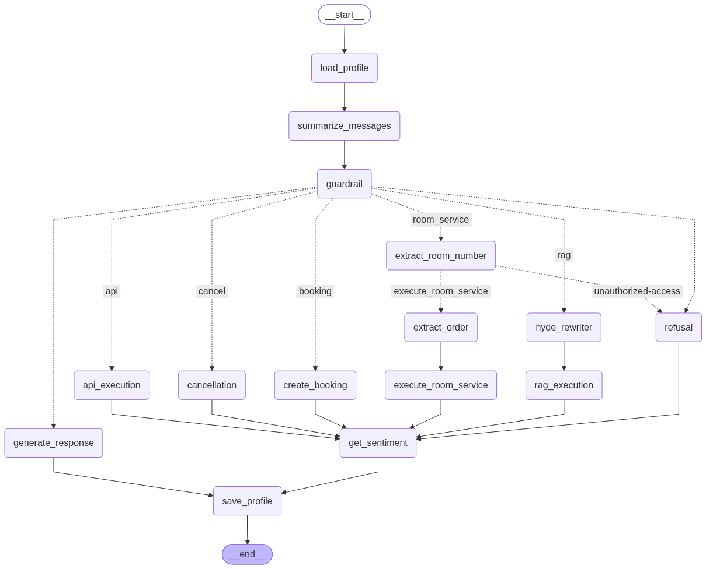
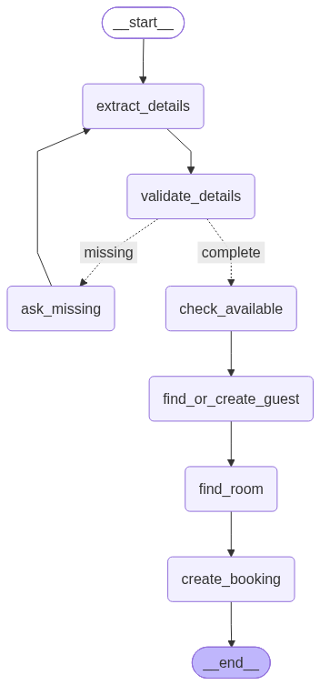
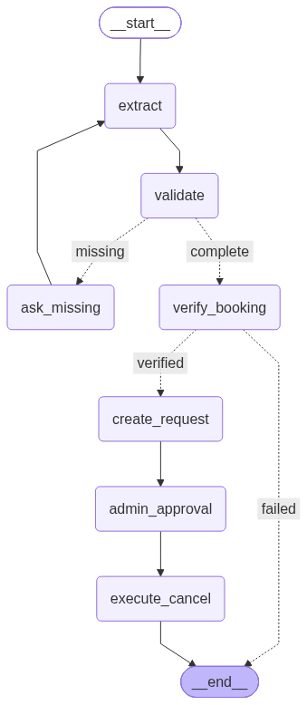

# 🛎️ AI Hotel Concierge (LangGraph + FastAPI)

An enterprise-grade, stateful AI agent built to simulate a virtual hotel front desk. Unlike basic Q&A chatbots, this system bridges the gap between unstructured natural language and strict database transactions, allowing users to query policies, check room availability, book rooms, and request room service seamlessly.

This project demonstrates advanced AI engineering concepts including Agentic Orchestration (LangGraph), Advanced RAG (HyDE & Query Rewriting), State & Memory Management, and Human-in-the-Loop (HITL) security via FastAPI.

## 🏗️ Architecture Overview

The system is broken down into three main layers:

Frontend (Chainlit): Provides a clean, conversational chat UI.

Orchestration Brain (LangGraph): Manages conversation state, memory, guardrails, and decision routing.

Action Execution (FastAPI): Serves as the toolkit for the agent, exposing REST endpoints to interact securely with the SQLite database.

## System Architecture

 

## ✨ Key Features

- Strict Domain Guardrails: A routing node intercepts prompts. If a user asks off-topic questions (e.g., "Write a Python script"), the workflow deflects it immediately, saving tokens and preventing prompt injection.

- Advanced RAG Pipeline: For hotel policy and facility queries, the system uses Query Rewriting to handle multi-part questions and HyDE (Hypothetical Document Embeddings) to improve vector search accuracy. Evaluated using Ragas.

- Stateful Memory: Utilizes LangGraph's short-term and persistent thread memory. The agent remembers dates, names, and room numbers across multiple turns without needing explicit repetition.

- Database Tools via FastAPI: The LLM dynamically extracts parameters from chat to execute API calls (GET /rooms/availability, POST /rooms/book, POST /room-service/order).

- Human-in-the-Loop (HITL) Security: Destructive database actions (like canceling a booking) halt the agent graph. FastAPI enforces Role-Based Access Control (RBAC) via JWTs, requiring an Admin to approve the cancellation before execution.

## 🎥 Live Demo Flow

[](https://youtu.be/RxQ3anUEvoU)

-  Guardrail Test: Rejecting off-topic coding requests.

-  RAG in Action: Answering multi-part policy questions using Query Rewriting and HyDE.

-  Contextual Read/Write: Checking family room availability for "tomorrow" and booking it seamlessly using thread memory.

-  Room Service: Ordering items specifically to the newly booked room.

-  Secure Cancellation: Attempting to cancel a booking triggers the HITL pause, waiting for Admin authorization.

## Booking subgraph



## Cancellation subgraph




## 📊 Pipeline Evaluation & Ablation Study (RAGAS)

To ensure enterprise-grade accuracy and prevent hallucinations, the LangGraph retrieval pipeline was mathematically evaluated using **RAGAS (Retrieval Augmented Generation Assessment)** across a 20-question ground-truth dataset testing complex multi-hop constraints.

### Phase 1: The Vector Search Bottleneck (Cosine Similarity)
Initially, we used standard Cosine Similarity to retrieve the top-K chunks. While it achieved decent Context Recall, the final generation metrics were unacceptably low for the advanced routing strategies.

| Metric (Cosine) | Naive (Base) | HyDE | Query Rewriter |
| :--- | :---: | :---: | :---: |
| **Context Recall** | 85.0% | 82.9% | 87.9% |
| **Answer Correctness**| 50.3% | 64.4% | **49.8%** (Critical Failure) |

**Diagnosis:** Cosine similarity retrieves the most mathematically similar chunks, leading to **redundancy**. For multi-constraint questions (e.g., "Can I bring my dog to the spa?"), the retriever pulled 5 chunks about dogs, and 0 chunks about the spa. The agent lacked diverse context, causing Answer Correctness to plummet.

### Phase 2: The MMR Upgrade (Maximal Marginal Relevance)
To solve this, we upgraded the FAISS retriever to use **MMR**, which optimizes for both relevance *and* diversity, penalizing duplicate information.

| Metric (MMR) | Naive (Base) | HyDE | Query Rewriter (Winner) |
| :--- | :---: | :---: | :---: |
| **Context Recall** | 74.2% | **91.2%** | **91.2%** |
| **Context Precision**| 69.8% | **78.6%** | 75.0% |
| **Faithfulness** | 79.9% | 82.4% | **88.6%** |
| **Answer Correctness**| 69.4% | 66.4% | **71.3%** |

**Key Optimization Learnings:**
* **Diversity Fixes Hallucinations:** By switching to MMR, the **Query Rewriter's Answer Correctness skyrocketed from 49.8% to 71.3%**, and Faithfulness jumped to 88.6%. The LLM was finally receiving diverse, non-redundant chunks, allowing it to correctly answer multi-part policies.
* **The Winning Architecture:** The **LangGraph Query Rewriter + MMR Retrieval** proved to be the most robust pipeline, tying for the highest recall (91.2%) while maintaining the highest truthfulness and accuracy.

## 🛠️ Tech Stack

- AI & Orchestration: Python, LangChain, LangGraph, OpenAI / Anthropic APIs

- Backend & API Tools: FastAPI, Pydantic, JWT Authentication

- Database: SQLite (Relational), FAISS (Vector DB for RAG)

- Evaluation: Ragas

- Frontend: Chainlit

## 🚀 Getting Started

Prerequisites

- Python 3.10+

- OpenAI API Key (or equivalent LLM provider)

Installation

Clone the repository:

```
git clone https://github.com/Anucool419/NovaDesk_AI.git
cd NovaDesk_AI
```


Set up a virtual environment:

```
python -m venv venv
source venv/bin/activate  # On Windows: venv\Scripts\activate
```

Install dependencies:

```
pip install -r requirements.txt
```

Environment Variables:
Create a .env file in the root directory and add:

```
OPENAI_API_KEY=your_api_key_here
SECRET_KEY=your_fastapi_jwt_secret
```

Running the Application

Start the FastAPI Backend:
In one terminal, start the tool server:

```
uvicorn main:app --reload --port 8000
```

Start the Chainlit Frontend/Agent:
In a second terminal, launch the UI:

```
chainlit run app.py -w --port 8001
```

Open http://localhost:8000 in your browser to start chatting!

## 🔮 Future Scope

1. Long-Term Memory: Integrate persistent storage to remember returning guests and their specific preferences across multiple different stays.

2. Modification Subgraph: Add a dedicated workflow to safely handle the complex state transitions required when altering an existing reservation.

3. Multi-Agent Architecture: Transition to a supervisor model that routes tasks to specialized, independent sub-agents (e.g., a dedicated Room Service Agent and a Booking Agent).

4. Voice-Based Interactions: Integrate speech-to-text capabilities to allow hands-free, natural spoken conversations with the virtual front desk.

## 🤝 Let's Connect

I'm documenting the build process and architectural decisions of this project on my DEV Community blog.

[Read my deep-dive articles here](https://dev.to/zeroshotanu/) | Connect on LinkedIn [](https://www.linkedin.com/in/ananya-s-6b300527a/)
